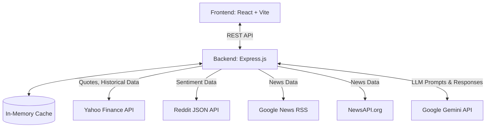
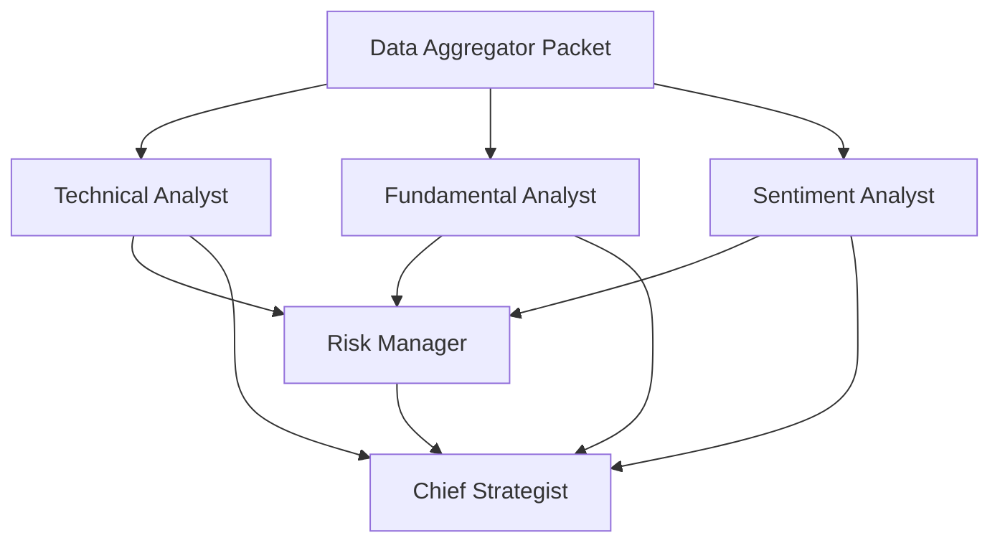

# StockSage India — System Architecture & Design Document

## 1. Overview
**StockSage India** is a React + Express application designed to act as an automated, AI-driven stock analyst. It fetches real-time and historical data for Indian stocks (NSE/BSE), calculates technical indicators, scrapes internet sentiment, and feeds this data through a multi-agent AI pipeline powered by Google Gemini.

---

## 2. High-Level Design (HLD)

### 2.1 System Architecture
The application follows a standard Client-Server architecture with integrations to external data providers and LLMs.

### 2.2 Core Data Flow (Analysis Request)
1. **Trigger**: User requests analysis for a symbol (e.g., `RELIANCE`).
2. **Aggregation (`dataAggregator.cjs`)**:
   - Server fetches in parallel: Quotes (Yahoo), 6mo/1yr Historical (Yahoo), News (Google/NewsAPI), Reddit Sentiment.
   - Calculates Technical Indicators (RSI, MACD, EMA, etc.) from historical data.
3. **AI Pipeline (`aiEngine.cjs`)**:
   - The aggregated data packet is passed to the AI Engine.
   - *Phase 1 (Parallel)*: Technical, Fundamental, and Sentiment agents analyze the data independently using Gemini Flash.
   - *Phase 2*: Risk Manager agent evaluates the outputs of Phase 1.
   - *Phase 3*: Chief Strategist agent (using Gemini Pro) synthesizes all previous outputs into a final actionable plan.
4. **Response**: JSON response containing charts, raw data, and the unified expert analysis is returned to the frontend and cached.

---

## 3. Low-Level Design (LLD)

### 3.1 Frontend Architecture (React)
- **State Management**: React `useState` and `useEffect`. LocalStorage is used for persisting `watchlist`, `settings`, and `recent_analyses`.
- **API Layer (`src/api.js`)**: A centralized `fetch` wrapper handling all communication with the backend.
- **Key Components**:
  - `Dashboard.jsx`: Entry point, stock search, and general market news.
  - `Watchlist.jsx`: Real-time tracking. Calculates "quick signals" locally (e.g., price vs. 50 DMA) without calling the AI, saving tokens.
  - `StockAnalysis.jsx`: Renders the detailed AI verdict, expert opinions, and `lightweight-charts` for technical visualization.
  - `PortfolioManager.jsx`: Handles CSV parsing (`csv-parse/sync`), calculates P&L, and triggers the `/portfolio/analyze-all` holistic AI endpoint.

### 3.2 Backend Services (Express/Node.js)

#### 3.2.1 Data Services
- `yahooFinance.cjs`: Handles ticker conversion (appends `.NS`), retries, and formatting.
- `technicalAnalysis.cjs`: Uses the `technicalindicators` library to compute RSI, MACD, Bollinger Bands, ADX, support/resistance, and volume ratios.
- `newsService.cjs`: Parses Google News RSS XML (`xml2js`) and dedupes articles based on string similarity.
- `redditService.cjs`: Fetches top posts from `r/IndianStreetBets` and `r/IndianStockMarket` and calculates engagement scores.

#### 3.2.2 AI Engine (`aiEngine.cjs` & `agentConfigs.cjs`)
The AI engine enforces structured JSON output from Gemini via schemas defined in `agentConfigs.cjs`.
**Optimization Detail**: 
Initially, agents ran sequentially. The current LLD runs them in a 3-phase optimized DAG (Directed Acyclic Graph):

### 3.3 Routing Maps
- `/api/stocks/search`, `/api/stocks/quote/:symbol`, `/api/stocks/historical/:symbol`
- `/api/analysis/init`, `/api/analysis/analyze`
- `/api/portfolio/upload`, `/api/portfolio/analyze-holding`, `/api/portfolio/analyze-all`

### 3.4 Caching Strategy (`cache.cjs`)
Custom in-memory TTL cache to reduce API limits and AI token costs.
- **Quotes**: 5 mins
- **Historical Data**: 1 hour
- **News & Reddit**: 30 mins
- **AI Analysis**: 30 mins

### 3.5 Rate Limiting (`rateLimiter.cjs`)
A Token Bucket algorithm is implemented to prevent IP bans from external sources and to respect Gemini API limits.
- **Yahoo Finance**: 5 req/sec
- **Reddit**: 3 req/sec
- **Google News**: 2 req/sec
- **Gemini**: 10 req/min (configurable)

---

## 4. Future Optimization Opportunities

If you return to this project in the future, consider the following optimizations based on this architecture:

1. **Database Integration (MongoDB/Postgres/Supabase)**: 
   - *Why*: Replace the in-memory cache and browser `localStorage`.
   - *Benefit*: Enables cross-device syncing, persistent portfolio tracking, and running background cron jobs for price alerts.
2. **WebSockets for Live Pricing**:
   - *Why*: Currently, the watchlist polls Yahoo Finance every 5 minutes.
   - *Benefit*: Lower latency for price updates and instant alert triggers.
3. **Advanced RAG (Retrieval-Augmented Generation)**:
   - *Why*: Currently, we send raw news headlines and reddit posts directly to Gemini's context window.
   - *Benefit*: Implementing a vector database to store historical earnings call transcripts or SEBI filings could make the Fundamental Analyst agent significantly more accurate and deeply aware of company history.
4. **Agent "Debate" Model**:
   - *Why*: Expand the Chief Strategist's synthesis step.
   - *Benefit*: Move from single-shot generation to a conversational "debate" model where the Technical and Fundamental analysts cross-examine each other before the Chief Strategist makes a final decision.
