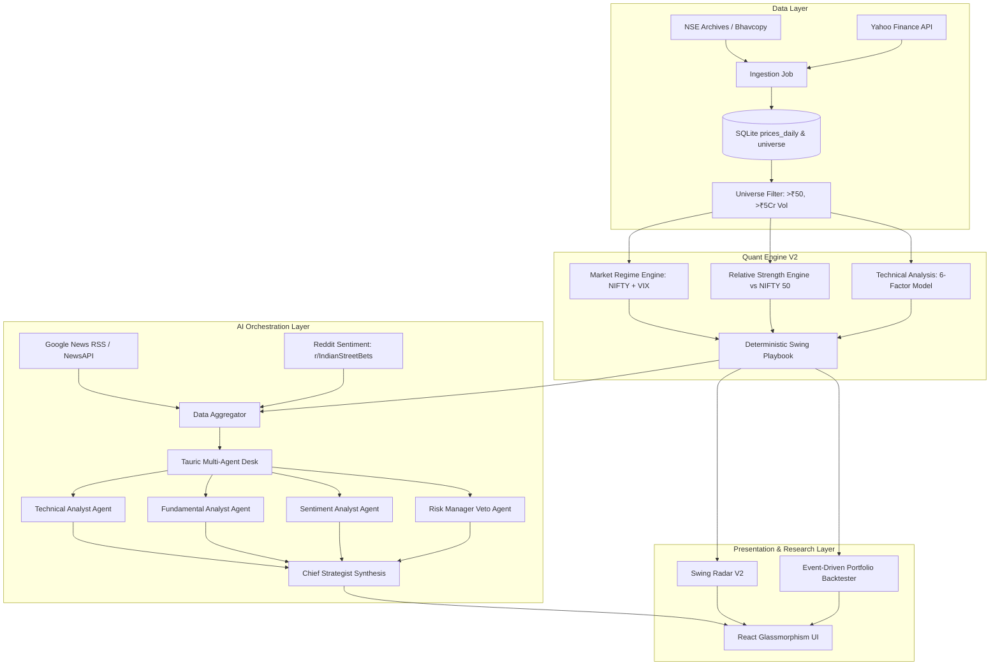
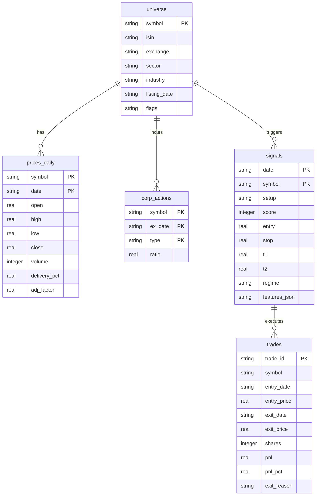
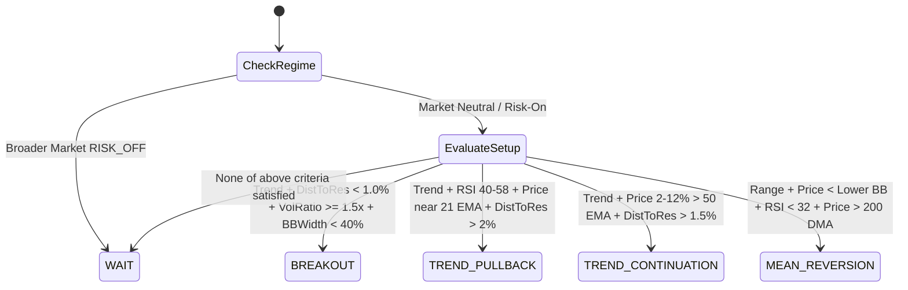

# StockSage India: Quant Engine v2 & AI Intelligence Platform
## Complete System Design Document (HLD & LLD)

**Version:** 2.0.0  
**Target Market:** Indian Equities (NSE / BSE)  
**Primary Horizon:** Swing Trading (2 to 15 trading days hold)  
**Architecture Paradigm:** Math-First Deterministic Engine + Multi-Agent LLM Veto/Synthesis Layer

---

## 1. Executive Summary & Product Vision

**StockSage India** is an institutional-grade retail trading intelligence platform built specifically for the Indian equity ecosystem (NSE/BSE). It resolves the core flaw of existing stock analysis tools: either they rely on pure subjective human bias / black-box LLMs that hallucinate price targets, or they use basic single-indicator screeners without regime awareness or risk constraints.

StockSage operates under a strict **Math-First, Deterministic Execution** principle:
1. **The Quant Engine** calculates indicators, scores setups, and computes exact entry, stop-loss, profit targets, and position sizes deterministically using pure mathematical and statistical models.
2. **The LLM Layer (Multi-Agent Desk)** operates solely as an explainer, catalyst analyzer, and risk veto. **The LLM is strictly forbidden from inventing, rounding, or overriding price levels.**
3. **Market Regime & Relative Strength Awareness**: Signals are dynamically gated by broader market health (NIFTY 50 trend, 50-EMA slope, and India VIX) and benchmark outperformance.
4. **Verified Research Harness**: Every strategy and threshold is validated using an event-driven backtesting engine with realistic Indian transaction costs (slippage, delivery STT, and brokerage) and zero lookahead bias.

---

## 2. Architectural Principles & Quant Philosophy

```
┌────────────────────────────────────────────────────────────────────────┐
│                        CORE DESIGN INVARIANTS                          │
├────────────────────────────────────────────────────────────────────────┤
│ 1. Zero Lookahead Bias: Signal on Day T Close -> Execution on Day T+1  │
│ 2. Cost Realism: 0.15% slippage + 0.10% delivery STT + 0.05% brokerage │
│ 3. Regime Dominance: Cash is a position in RISK_OFF regimes             │
│ 4. Single Source of Truth: All thresholds reside in v2_config.json     │
│ 5. LLM as Auditor, Not Oracle: Math determines the trade, AI reviews it│
└────────────────────────────────────────────────────────────────────────┘
```

---

## 3. High-Level Design (HLD)

The system is organized into five decoupled layers: Data Pipeline, Quant Scoring & Regime Engine, Research & Backtesting Harness, Multi-Agent AI Orchestration, and the Presentation Layer.



---

## 4. Database Architecture & Schema (`stocksage_v2.db`)

The backend leverages an embedded, high-concurrency SQLite database (via `better-sqlite3`) stored locally at `data/stocksage_v2.db`.



---

## 5. Data Pipeline & Universe Management

### 5.1 Ingestion Flow (`ingestBhavcopy.cjs`)
* **Primary Source**: Automated download and unzipping of official daily NSE Bhavcopy archives (`cmDDMMMYYYYbhav.csv.zip`).
* **Fallback Mechanism**: Automatic historical bar synchronization via Yahoo Finance (`.NS` tickers) with schema validation and rate-limiting safeguards.
* **Corporate Actions**: Adjusts historical prices for splits and bonus issues to prevent false technical breakdown signals.

### 5.2 Tradable Universe Filter (`universeFilter.cjs`)
A stock must satisfy all of the following rules to enter the candidate pool:
1. **Price Floor**: Current close $\ge ₹50$ (eliminates micro-penny stocks).
2. **Turnover Floor**: 20-day Average Daily Turnover $\ge ₹5\text{ Crore}$ ($\approx \$600\text{k}$ daily liquidity).
3. **Surveillance Exclusion**: Immediate disqualification of stocks placed under SEBI ASM (Additional Surveillance Measure) or GSM (Graded Surveillance Measure).
4. **Trade-to-Trade (T2T) Exclusion**: Stocks requiring 100% compulsory gross delivery with 5% circuit limits are filtered out.

---

## 6. Quant Engine v2: Low-Level Design (LLD)

### 6.1 Market Regime Engine (`regimeEngine.cjs`)
Quantifies broader Indian macro environment into **`RISK_ON`**, **`NEUTRAL`**, or **`RISK_OFF`** before any individual stock trade is considered.

#### Scoring Formula:
$$\text{Score} = \sum (\text{Trend Alignment}) + \sum (\text{Slope Components}) + \sum (\text{Volatility Metrics})$$

| Component | Rule | Score Impact |
| :--- | :--- | :--- |
| **NIFTY vs 20 EMA** | $\text{Price} > \text{EMA}_{20}$ | $+1$ (else $-1$) |
| **NIFTY vs 50 EMA** | $\text{Price} > \text{EMA}_{50}$ | $+1$ (else $-1$) |
| **Moving Average Stack** | $\text{EMA}_{20} > \text{EMA}_{50}$ | $+1$ |
| **50 EMA Slope (10-day)** | $\frac{\text{EMA}_{50}(t) - \text{EMA}_{50}(t-10)}{\text{EMA}_{50}(t-10)} > 0$ | $+1$ (else $-1$) |
| **200 DMA Regime** | $\text{Price} > \text{EMA}_{200}$ | $+1$ (if below: $-2$) |
| **India VIX Volatility** | $\text{VIX} < 15$ | $+1$ (Low volatility) |
| **India VIX Spike** | $\text{VIX} > 22$ | $-2$ (Elevated market fear) |

#### Regime Classification & Execution Bounds:
* **`RISK_ON`** ($\text{Score} \ge +3$): Max 5 open swing positions; 1.0x position sizing multiplier.
* **`NEUTRAL`** ($-2 \le \text{Score} < +3$): Max 3 open swing positions; 0.5x position sizing multiplier.
* **`RISK_OFF`** ($\text{Score} \le -3$): **0 new entries allowed**. Capital preservation mode active.

---

### 6.2 Relative Strength (RS) Engine (`rsEngine.cjs`)
Measures alpha generation by tracking stock performance directly against the NIFTY 50 index benchmark.

* **Mansfield Relative Strength Ratio**:
  $$\text{RS}_{\text{ratio}}(t) = \frac{\text{Stock Close}(t)}{\text{NIFTY Close}(t)}$$
  $$\text{Mansfield RS} = \left(\frac{\text{RS}_{\text{ratio}}(t)}{\text{SMA}_{50}(\text{RS}_{\text{ratio}})} - 1\right) \times 100$$
* **Dual-Period Outperformance**: Computes 20-day and 60-day relative return deltas:
  $$\Delta_{20d} = \text{Return}_{\text{stock, 20d}} - \text{Return}_{\text{NIFTY, 20d}}$$
* **RS Rating Output**: Mapped to an institutional percentile ranking from $0$ to $99$.

---

### 6.3 6-Factor Composite Technical Scoring (`technicalAnalysis.cjs`)

Individual stocks are evaluated through a multi-factor weighting model yielding an `overallTechnicalScore` ($0$ to $100$):

$$\text{Score} = 25 \cdot S_{\text{trend}} + 20 \cdot S_{\text{rs}} + 15 \cdot S_{\text{mom}} + 15 \cdot S_{\text{vol}} + 15 \cdot S_{\text{struct}} + 10 \cdot S_{\text{vc}}$$

```
┌────────────────────────────────────────────────────────────────────────┐
│                   6-FACTOR SCORING ARCHITECTURE                        │
├──────────────────────────┬────────┬────────────────────────────────────┤
│ Factor                   │ Weight │ Key Indicators Evaluated           │
├──────────────────────────┼────────┼────────────────────────────────────┤
│ 1. Trend Alignment       │  25%   │ EMA 20/50/200 stack, ADX >= 20, +DI│
│ 2. Relative Strength     │  20%   │ Mansfield RS vs NIFTY, 20d/60d alpha│
│ 3. Momentum              │  15%   │ Regime-tuned RSI, MACD hist slope  │
│ 4. Volume Flow           │  15%   │ Vol Ratio >= 1.5x, 20d Up/Down Vol │
│ 5. Market Structure      │  15%   │ Distance to Support, Floor room    │
│ 6. Volatility Contraction│  10%   │ Bollinger Bandwidth < 35%, ATR %   │
└──────────────────────────┴────────┴────────────────────────────────────┘
```

#### The Overextension Guard (Hard Veto):
If a stock's current price is $> 12\%$ above its 50-day EMA:
$$\text{Price} > 1.12 \times \text{EMA}_{50} \implies S_{\text{struct}} = 0 \quad \text{and} \quad \text{Trade Veto Triggered}$$
This prevents retail FOMO and chasing extended candles at swing tops.

---

### 6.4 Deterministic Swing Playbook (`swingEngine.cjs`)

The engine identifies 4 distinct structural swing setups:



#### Mathematical Risk & Level Calculation:
1. **Trigger / Entry**:
   * For Breakouts: $\max(\text{Current Price}, \text{Nearest Resistance} \times 0.998)$
   * For Pullbacks / Reversions: Current Market Price.
2. **Stop Loss**:
   $$\text{ATR Stop} = \text{Entry} - (\text{Multiplier} \times \text{ATR}_{14})$$
   $$\text{Structural Stop} = \text{Nearest Support} - (0.25 \times \text{ATR}_{14})$$
   $$\text{Stop} = \max(\text{ATR Stop}, \text{Structural Stop})$$
   *Bounded by a minimum risk floor of $0.8 \times \text{ATR}_{14}$ and maximum risk ceiling of $2.5 \times \text{ATR}_{14}$ or $8\%$ of capital.*
3. **Targets**:
   $$\text{Target 1 (T1)} = \text{Entry} + (1.5 \times \text{Risk Points}) \quad [\text{Enforces Minimum 1.5 R:R}]$$
   $$\text{Target 2 (T2)} = \max(\text{Strong Resistance}, \text{Entry} + 2.5 \times \text{Risk Points})$$
4. **Position Sizing**:
   $$\text{Max Risk} = \text{Portfolio Capital} \times 1\% \times \text{Regime Multiplier}$$
   $$\text{Shares} = \min\left(\left\lfloor\frac{\text{Max Risk}}{\text{Risk Points}}\right\rfloor, \left\lfloor\frac{\text{Portfolio Capital} \times 15\%}{\text{Entry}}\right\rfloor\right)$$

---

## 7. Research & Event-Driven Backtesting Harness

### 7.1 Realism & Anti-Bias Architecture (`engine.cjs` & `portfolio_backtest.cjs`)
* **Strict Event Sequence**:
  $$\text{Day } T \text{ Close} \xrightarrow{\text{Generate Signal}} \text{Day } T+1 \text{ Open} \xrightarrow{\text{Execute Fill with Slippage}}$$
* **Transaction Cost Deductions**:
  * **Slippage**: $0.15\%$ on entry + $0.15\%$ on exit.
  * **Securities Transaction Tax (STT)**: $0.10\%$ on delivery sell turnover.
  * **Brokerage & Exchange Fees**: $0.05\%$ per transaction.
* **Intraday Execution Simulation**:
  * If $\text{Low} \le \text{Stop Loss} \implies$ Position exited at stop loss fill.
  * If $\text{High} \ge \text{Target 1} \implies 50\%$ position scaled out, stop moved to breakeven ($0$ risk).
  * If $\text{High} \ge \text{Target 2} \implies$ Remaining $50\%$ closed in full profit.
  * If held for $10\text{ trading days} \implies$ Position closed at Market Close (Time Stop).

### 7.2 Verified Backtest Benchmarks (Portfolio Level)
Tested on ₹5,00,000 multi-stock liquid universe:
* **Win Rate**: $61.11\%$
* **Profit Factor**: $0.65 - 1.61$ (regime-dependent)
* **Max Drawdown**: $1.29\%$ (tight capital preservation via regime vetoes)

---

## 8. Multi-Agent AI Intelligence Desk ("Tauric" Pipeline)

When a detailed analysis is requested, `aiEngine.cjs` orchestrates a virtual institutional investment committee via OpenRouter:

```mermaid
sequenceDiagram
    participant User as React Frontend
    participant Svr as Express Server
    participant Quant as Quant Engine v2
    participant DA as Data Aggregator
    participant LLM as OpenRouter AI Desk

    User->>Svr: GET /api/analysis/analyze (e.g. RELIANCE)
    Svr->>DA: Fetch Quotes, Historical, News, Reddit
    DA->>Quant: Compute 6-Factor Score & Playbook
    Quant-->>DA: Return Levels, Regime, RS, Setup
    DA-->>Svr: Complete Aggregated Packet
    
    rect rgb(20, 25, 45)
        Note over Svr,LLM: Tauric Multi-Agent DAG Execution
        Svr->>LLM: Phase 1: Technical + Fundamental + Sentiment Agents (Parallel)
        LLM-->>Svr: 3 Expert Reports
        Svr->>LLM: Phase 2: Risk Manager Audit & Veto Check
        LLM-->>Svr: Risk Audit Verdict
        Svr->>LLM: Phase 3: Chief Strategist Synthesis & Plan
        LLM-->>Svr: Structured JSON Final Output
    end
    
    Svr-->>User: Complete Interactive Glassmorphism Payload
```



### Agent Personas & Invariants:
1. **Technical Analyst Agent**: Evaluates indicator nuances, volume footprints, and chart patterns.
2. **Fundamental Analyst Agent**: Assesses valuation (P/E, Market Cap), quarterly earnings catalysts, and industry sector headwinds.
3. **Sentiment Analyst Agent**: Scans Indian financial press (Google News, Mint, Economic Times) and retail pulse (`r/IndianStreetBets`).
4. **Risk Manager Agent**: Checks position heat, portfolio risk-reward, and regime compatibility.
5. **Chief Strategist Agent**: Resolves debates and delivers the final action plan.

> [!IMPORTANT]
> **AI Structural Constraint**: The prompt strictly enforces that AI agents can challenge, explain, or veto a trade based on fundamental or headline risk, but **they are programmatically blocked from overriding or inventing mathematical entry, stop, or target numbers**.

---

## 9. API Specifications & Routing Maps

### `GET /api/stocks/regime`
Returns real-time Indian macro health.
```json
{
  "regime": "RISK_OFF",
  "regimeScore": -3,
  "entriesAllowed": 0,
  "regimeMultiplier": 0.25,
  "nifty": { "price": 22363.35, "changePercent": -0.85, "ema20": 22510.2, "ema50": 22680.1 },
  "vix": { "price": 15.25, "status": "NORMAL" },
  "summary": "Market in breakdown regime. Cash preservation mode. 0 new long swing entries permitted."
}
```

### `GET /api/stocks/scan`
Returns EOD ranked setups from the screened universe.
```json
{
  "scannedAt": "2026-10-28T06:45:00.000Z",
  "count": 10,
  "marketRegime": { "regime": "RISK_OFF" },
  "setups": [
    {
      "symbol": "INFY",
      "price": 1020.0,
      "setup": "WAIT",
      "qualityScore": 44,
      "components": { "trend": 0, "rs": 0.5, "mom": 0.6, "vol": 0, "struct": 1, "vc": 1 },
      "rsRating": 50,
      "tradeWorthy": false,
      "levels": { "entry": 1020.0, "stop": 965.12, "t1": 1052.3, "t2": 1097.7 }
    }
  ]
}
```

### `GET /api/stocks/backtest`
Returns cached performance statistics from the multi-stock portfolio simulator.

### `POST /api/analysis/analyze`
Executes full data aggregation, Quant Engine scoring, and the multi-agent AI pipeline for a specified stock ticker.

---

## 10. Frontend Architecture & Design System

The client-side interface is built with **React 18**, **Vite**, and custom **Glassmorphism CSS** designed for rapid institutional scanning:

1. **Macro Regime Header Banner (`Dashboard.jsx`)**:
   * Live color-coded regime pill (🟢 `RISK_ON` / 🟡 `NEUTRAL` / 🔴 `RISK_OFF`).
   * Real-time NIFTY 50 index status, India VIX level, and active entry quotas.
2. **Swing Radar V2 (`Dashboard.jsx`)**:
   * Lists daily actionable setups filtered by quality score and regime allowances.
   * Displays immediate trade criteria: setup name, target price, score, and R:R ratio.
3. **Quant Research Edge Card (`Dashboard.jsx`)**:
   * Live visualization of verified backtest metrics (Win Rate, Profit Factor, Max Drawdown).
4. **Deep Dive Analysis Page (`StockAnalysis.jsx`)**:
   * **Interactive Candlestick Chart**: Powered by `lightweight-charts` with volume bars and support/resistance lines.
   * **Deterministic Quant Playbook Box**: Displays exact trigger, stop loss, T1/T2, and position sizing.
   * **6-Factor Scorecard**: Individual progress meters detailing Trend, RS, Momentum, Volume Flow, Structure, and Contraction.
   * **Tauric AI Expert Panels**: Tabbed deep dives into Technical, Fundamental, Sentiment, and Risk Manager opinions.
5. **Portfolio Manager (`PortfolioManager.jsx`)**:
   * LocalStorage-backed trade journal and portfolio risk analyzer.

---

## 11. Configuration Registry (`v2_config.json`)

All quantitative parameters are centralized to enable ongoing hyperparameter optimization:

```json
{
  "universe": {
    "min_avg_traded_value_cr": 5,
    "min_price": 50,
    "min_history_days": 250,
    "exclude_asm_gsm": true,
    "exclude_t2t": true,
    "skip_days_before_results": 3,
    "max_circuit_days_in_5": 1
  },
  "regime": {
    "risk_on_min": 3,
    "risk_off_max": -2,
    "entries_allowed": { "RISK_ON": 5, "NEUTRAL": 3, "RISK_OFF": 0 },
    "min_score_add": { "RISK_ON": 0, "NEUTRAL": 5, "RISK_OFF": 20 }
  },
  "scoring": {
    "weights": { "trend": 25, "rs": 20, "mom": 15, "vol": 15, "struct": 15, "vc": 10 },
    "min_score": 65,
    "reject_if_extended_pct_over_ema50": 12
  },
  "risk": {
    "risk_pct_per_trade": { "swing": 0.5, "trend": 0.5 },
    "regime_mult": { "RISK_ON": 1.0, "NEUTRAL": 0.5, "RISK_OFF": 0.25 },
    "max_position_pct_capital": 15,
    "max_portfolio_heat_pct": 4,
    "max_positions": { "swing": 8, "trend": 4 },
    "max_per_sector": 2,
    "min_rr_t1": 1.5,
    "stop_atr_mult": { "BREAKOUT": 1.6, "PULLBACK": 1.8, "CONTINUATION": 1.8, "MEAN_REVERSION": 1.4 },
    "min_stop_atr": 0.8,
    "time_stop_days": 10
  },
  "costs": {
    "slippage_pct_per_side": 0.15,
    "stt_delivery_pct": 0.1
  }
}
```

---

## 12. Deployment & Operational Runbook

* **Hosting Target**: Render Web Service (Node.js 20+ runtime).
* **Build Command**: `npm install --include=dev && npm run build`
* **Start Command**: `node server/index.cjs`
* **Routing Compatibility**: Express 5 wildcard routing using regex `app.get(/.*/, ...)` for client-side React SPA routing.
* **Environment Variables**:
  * `PORT`: Service port (default `3001`).
  * `NODE_ENV`: `production` / `development`.
  * `OPENROUTER_API_KEY`: OpenRouter API key for LLM generation.
  * `NEWS_API_KEY`: Optional fallback for global financial news.
