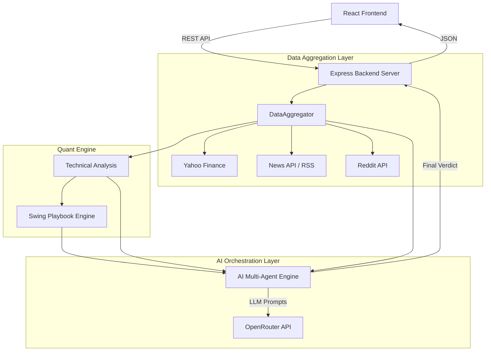

# StockSage India: End-to-End System Design

## 1. Executive Summary
**StockSage India** is an AI-powered stock analysis and swing-trading intelligence platform. It aggregates raw market data, technical indicators, news, and social sentiment, feeding it into a multi-layered quant engine and an LLM-based multi-agent expert desk to generate actionable trading insights.

---

## 2. Technology Stack
* **Frontend**: React 18, Vite, Vanilla CSS (Glassmorphism design system)
* **Backend**: Node.js, Express.js
* **AI / Intelligence**: OpenRouter API (Nemotron 3 Ultra, Llama 3.1, Gemini Flash/Pro)
* **Data Sources**: 
  * `yahoo-finance2` (Market Data, OHLCV, Fundamentals)
  * `NewsAPI` / Google News RSS (Catalysts & Market News)
  * Reddit API (Retail Sentiment on r/IndianStreetBets, etc.)
* **Caching**: In-memory TTL Cache (Node.js Map)

---

## 3. High-Level Design (HLD)

The system follows a standard Client-Server architecture but heavily emphasizes a **Data Pipeline** and an **AI Orchestration Pipeline** on the backend.

### Core Pipelines
1. **The Quant Engine (`swingEngine.cjs`)**: A deterministic, math-based scoring system. It evaluates RSI, ADX, Bollinger Bands, and EMA stacks to flag setups (e.g., Mean Reversion, Breakouts, Trend Continuations) and hard-calculates risk/reward limits before AI opinion is even requested.
2. **The "Tauric" Multi-Agent AI Desk (`aiEngine.cjs`)**: Instead of relying on a single LLM prompt, the backend spins up a virtual trading desk. It routes data through distinct "personas" (Technical Analyst, Fundamental Analyst, Risk Manager) and forces them to debate before a "Chief Strategist" outputs the final JSON.

---

## 4. Low-Level Design (LLD)

### 4.1 Backend Service Modules (`server/services/`)

* **`dataAggregator.cjs`**: The conductor for external APIs. It runs parallel asynchronous fetches (`Promise.allSettled`) to gather quote data, 6-month historical data, news, and Reddit sentiment.
* **`technicalAnalysis.cjs`**: Pure math module. Takes historical OHLCV data and calculates RSI(14), MACD, ATR, ADX, Bollinger Bands, and identifies Support/Resistance levels using local minima/maxima clustering.
* **`swingEngine.cjs`**: The rules-based quant filter. It assigns a `qualityScore` (0-100) based on momentum and trend logic. It generates exact entry, stop-loss, and target levels based on ATR (Average True Range).
* **`agentConfigs.cjs`**: Stores the System Prompts and JSON Output Schemas for every AI persona (Bull, Bear, Risk Manager, Trader, etc.).
* **`aiEngine.cjs`**: Manages the OpenRouter API interaction. Implements fallback logic (e.g., if Nemotron 3 Ultra hits a rate limit, fallback to Llama 3.1), retry mechanisms, and parses the structured JSON output from the LLMs.
* **`screener.cjs`**: A background job/endpoint that loops over a predefined universe of stocks (Large/Mid caps), running them through the `swingEngine` to find the daily "Top Picks" without making expensive AI calls.

### 4.2 Frontend Architecture (`src/`)

* **`App.jsx`**: Main router and state holder. Uses `React.lazy` and `Suspense` for code-splitting routes.
* **`Dashboard.jsx`**: The landing page. Handles the search bar, renders the Market News feed, and auto-fetches the `Swing Radar` from the backend screener.
* **`StockAnalysis.jsx`**: The core visualization component. Renders the AI's JSON response into interactive glass-cards (Verdict, Expert Deep Dives, Technical Charts). 
* **`PortfolioManager.jsx`**: Manages local state (localStorage) for user holdings, simulating PnL based on live prices fetched from the backend.
* **`api.js`**: Axios/Fetch wrapper handling all API communication with the Express backend, standardizing error handling.

---

## 5. Data Flow Trace: "Analyze Stock"

1. **User Input**: User searches for "RELIANCE" and clicks Analyze.
2. **Client Request**: Frontend calls `GET /api/stocks/analyze/RELIANCE`.
3. **Caching**: Backend checks `cache.cjs`. If a valid analysis exists < 15 mins old, return immediately.
4. **Data Aggregation**: `dataAggregator.cjs` fetches YF quotes, YF historical, News, and Reddit in parallel.
5. **Technical Math**: Historical data is piped into `technicalAnalysis.cjs` to generate indicator values.
6. **Quant Playbook**: Technicals are piped into `swingEngine.cjs` to see if a deterministic trade setup exists.
7. **AI Analyst Phase**: The aggregated data + quant playbook is sent to the OpenRouter API using the `analystTeam` prompt.
8. **AI Decision Phase**: The output of the Analysts is fed into the `decisionRoom` prompt, forcing a debate between Bull and Bear, supervised by a Risk Manager.
9. **Finalization**: The backend maps the raw LLM JSON into a strict response schema.
10. **Client Render**: Frontend receives the JSON and maps it to the UI components.

---

## 6. Scalability & Extensibility

* **Stateless Backend**: The Express server is entirely stateless (only using an in-memory cache). It can be horizontally scaled across multiple containers (e.g., Docker, AWS ECS).
* **Model Agnostic**: Because `aiEngine.cjs` uses OpenRouter, swapping LLM providers (OpenAI, Anthropic, Google, Meta) requires changing a single string in the `PRO_MODELS` array.
* **Database Ready**: Currently relying on `localStorage` for portfolios and in-memory caching. To scale to thousands of users, the cache can be swapped for **Redis**, and portfolios can be migrated to **PostgreSQL/MongoDB** without altering the core pipelines.
