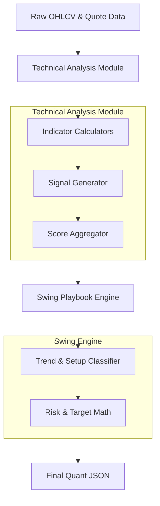

# Technical Scoring & Quant Engine: System Design (HLD & LLD)

## 1. Executive Summary
This document outlines the End-to-End (E2E) architecture, High-Level Design (HLD), and Low-Level Design (LLD) of the **Technical Scoring & Swing Quant Engine** used within the StockSage India platform. 

Its primary purpose is to ingest raw OHLCV (Open, High, Low, Close, Volume) data, compute standard mathematical indicators, generate discrete trading signals, and produce a normalized `overallTechnicalScore` (0-100) along with a deterministically generated swing trading playbook.

---

## 2. High-Level Design (HLD)

The Quant Engine operates entirely synchronously once the OHLCV data is provided by the upstream `DataAggregator`. It is decoupled from the AI/LLM layer, meaning it acts as a deterministic filter *before* any AI processing occurs.



### Core Components
1. **Data Ingestion**: Takes an array of daily objects containing `{ open, high, low, close, volume }` (min. 30 days, optimal 120-250 days).
2. **Indicator Compute Layer**: Uses the `technicalindicators` npm package to calculate RSI, MACD, EMAs, SMA, ADX, ATR, and Bollinger Bands.
3. **Signal Generation**: Evaluates current and previous indicator states to generate discrete events (e.g., `BULLISH_CROSSOVER`, `OVERSOLD`).
4. **Scoring Engine**: Normalizes the signals into a base-50 score.
5. **Swing Playbook**: Uses the score + ATR + Support/Resistance levels to formulate entry, stop-loss, and take-profit levels.

---

## 3. Low-Level Design (LLD)

### 3.1 `technicalAnalysis.cjs` (Indicator & Scoring Logic)

#### A. Indicator Computation (`calculateIndicators`)
- **RSI (14)**: Measures momentum.
- **MACD (12, 26, 9)**: Measures trend direction and momentum shifts.
- **EMA (9, 21, 50, 200)**: Used for dynamic support/resistance and trend stacking.
- **Bollinger Bands (20, 2)**: Measures volatility and standard deviation stretches.
- **ADX (14)**: Measures the absolute *strength* of a trend, regardless of direction.
- **ATR (14)**: Average True Range, used purely to calculate volatility-adjusted stop losses.

#### B. Signal Generation (`generateSignals`)
Takes the raw indicator values and applies logical thresholds to push discrete objects into a `signals` array.
*   *RSI*: `< 30` -> BULLISH (+8), `> 70` -> BEARISH (-8).
*   *MACD*: `histogram` flip from negative to positive -> BULLISH_CROSSOVER (+8).
*   *Bollinger Bands*: `price > upper` -> BEARISH (-8), `price < lower` -> BULLISH (+8).
*   *Volume*: `currentVolume / avgVolume20 > 2.0` -> ALERT (No score impact, metadata only).

#### C. Scoring Algorithm (`calculateTechnicalScore`)
The score operates on a base of `50` (Neutral).
```javascript
function calculateTechnicalScore(signals) {
  let score = 50; 
  signals.forEach(s => {
    if (s.type === 'BULLISH') score += 8;
    else if (s.type === 'BEARISH') score -= 8;
  });
  return Math.max(0, Math.min(100, score));
}
```
*Edge Case Management*: If a stock is trading sideways with normal volume and mid-range RSI (e.g., RSI 50), the `signals` array is empty, and the engine correctly returns `50`.

---

### 3.2 `swingEngine.cjs` (Trade Setup & Risk Math)

The Swing Engine classifies the raw technicals into one of several predefined playbooks.

#### A. Setup Classification Logic
1. **Trend Definition**: `trending = ADX >= 15`. If ADX is lower, the stock is trapped in a range.
2. **Setup Types**:
    *   **TREND_PULLBACK**: Uptrend + RSI between 38-58 + Distance to Resistance > 2%.
    *   **BREAKOUT**: Uptrend + Distance to Resistance < 0.8% + Volume Ratio > 1.4.
    *   **MEAN_REVERSION**: Price below lower Bollinger Band + RSI < 35.
    *   **TREND_CONTINUATION**: Uptrend + ADX > 15 + Distance to Resistance > 1%.
    *   **WAIT**: Triggered automatically if none of the above are met, or if the stock is sideways with no edge.

#### B. Risk Math & Level Generation
Stop losses and profit targets are strictly tied to **ATR (Average True Range)** to account for individual stock volatility, rather than fixed percentages.
- **Stop Loss**: 
  - Mean Reversion setup: `entry - (1.4 * ATR)`
  - Breakout setup: `entry - (1.6 * ATR)`
  - Default: `entry - (1.8 * ATR)`
- **Take Profit (T1/T2)**:
  - Required minimum Risk/Reward is `1.5`.
  - `T1 = entry + (risk * 1.5)`
  - `T2 = entry + (risk * 2.5)`

#### C. Final Output Schema
The engine outputs a strict JSON object that is consumed by the AI Agent layer as context:
```json
{
  "setup": "TREND_CONTINUATION",
  "bias": "LONG",
  "qualityScore": 62,
  "tradeWorthy": true,
  "riskRewardT1": 1.5,
  "entry": 250.50,
  "stop": 235.00,
  "t1": 273.75,
  "howToTrade": "BUY zone ₹250.50. Stop ₹235.00. Take 50% at T1...",
  "why": ["ADX at 25 shows strong trend", "Price above 50 EMA"]
}
```

## 4. Known Limitations & Review Points
1. **Lookback Constraint**: Currently constrained by the amount of OHLCV data passed in (e.g., 6 months vs 1 year). The 200 DMA cannot be accurately calculated natively if less than 200 trading days of data is passed.
2. **False Breakouts**: The current Breakout volume threshold (`> 1.4x`) is static. It does not account for time-of-day volume profiles.
3. **Weighting Mechanism**: The `+8` / `-8` scoring is a static heuristic. A more advanced V2 implementation could weight MACD crossovers heavier than RSI stretches based on historical backtesting.
